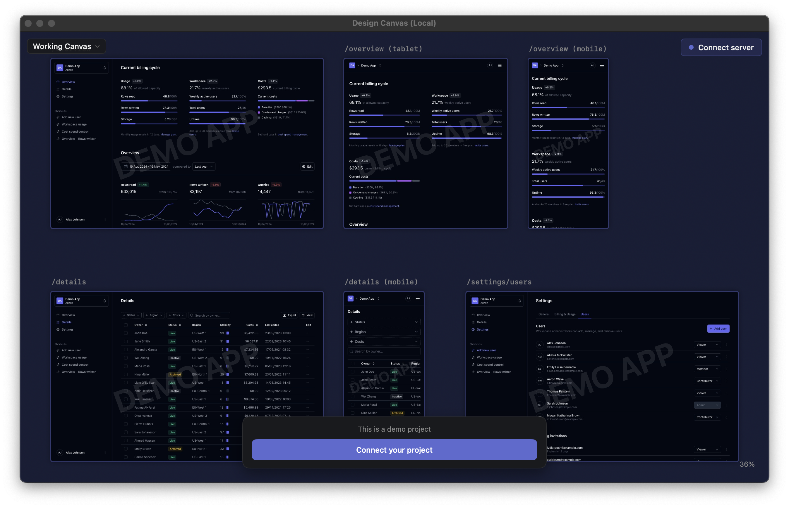

# Export verification — 6 October 2026

Verification ran on macOS 15.6 (Apple Silicon), Xcode 26.3 and Node.js 22.23.2.

| Check | Evidence |
| --- | --- |
| Native build and tests | Fresh clone resolved only public Swift dependencies and built without a developer account or distribution credentials; ad hoc signed Debug app; **97 XCTest cases passed**, including route recovery, restored URL-resolution tests, offline demo rendering/capture, opt-out account behavior, local MCP onboarding and build policy |
| Optimized local build | Release build succeeded for **arm64 and x86_64**; ad hoc signature with no team; `codesign --verify --deep --strict` passed; local bundle identity, official-distribution flag `NO`, automatic-update checks disabled |
| Mac runtime | Launched the native app, inspected the fictional canvas and verified that its process listened only on loopback; local bundle ID `com.designcanvas.app.local`, signature `adhoc`, no team, official-distribution flag `NO` |
| Native HTTP boundary | Requests without authentication returned **401**; an invalid Host returned **403**; an authenticated request returned **200** |
| MCP tests | **53 tests passed**; TypeScript build passed |
| Real packaged MCP session | Installed the reviewed npm tarball into a separate consumer; CLI help worked; MCP initialization exposed **16 tools**; adding, listing and removing a Markdown fixture worked; capture returned an image block |
| MCP package contents | **23 files**, 32,039 bytes packed; only compiled JavaScript/declarations, README, package metadata and MIT licence; no test fixtures, planning, credentials, source checkout or local configuration |
| MCP dependency audit | `npm audit --omit=dev`: **0 vulnerabilities** at verification time |
| Fictional demo | Next.js **15.5.24** production build passed; **10** browser checks across five routes and desktop/tablet/mobile sizes returned 200 with no page errors; regenerated bundled screenshots use fictional data and `example.com` addresses |
| Export review | Explicit source allowlist, reviewed changes and tracked-tree/path/credential scans; no submodules, private planning/research, agent settings, credentials, user data, hosted-service source or original Git history |
| Rights and notices | Selected source history identified one human author, Charlie Ellington; retained Tremor, marked, highlight.js, Remix Icon, Swifter and Sparkle notices; no separate human contributor rights identified |

The local verification logs and detailed receipts are retained outside the public tree. Checks can be reproduced with the repository's build/test scripts and MCP package commands.



## Official download continuity

The live feed at `https://www.designcanvas.app/appcast.xml` advertised **0.6.2 (build 10)**, with a 19 May 2026 publication date. The downloaded DMG is **7,455,660 bytes**:

```text
SHA-256: 57435f3fd3c258a01a1030be0c05a23186981b7a4afe7f280204031936a55fc1
```

The DMG's app reports 0.6.2 (10), contains arm64 and x86_64 binaries, and is signed by the original Developer ID team with a **19 May 2026, 18:11:38** timestamp. `codesign --verify --deep --strict` and `xcrun stapler validate` passed. The live appcast's length and Ed25519 signature were verified against that exact downloaded DMG using the existing public update key.

[Official download](https://3ihcvz3ujnsmr1ym.public.blob.vercel-storage.com/downloads/DesignCanvas.dmg). No DMG, updater feed or website was republished by this export. This source includes later work and is **not the source provenance of that older binary**. The published npm `design-canvas-mcp` version remains 0.6.0; the reviewed source adapter/package has not been published to npm as a new version.

## Limits

- The hosted sharing service, websites and pinned-comments roadmap are excluded. Link creation requires an explicitly configured backend implementing the existing protocol. The Share as Image menu is an inherited disabled placeholder; MCP capture works.
- Local builds are ad hoc signed and do not update through the official channel. No new signed/notarized binary has been released. macOS 14 and Intel runtime behavior have not been exercised on this machine.
- Optional Claude usage uses an unofficial endpoint; Codex usage depends on the installed local CLI. Account logins and live subscription polling were not exercised, to avoid account access during this verification.
- The fictional demo is bound to loopback and intended as a development fixture. Its dependency audit still reports **1 high, 3 moderate and 1 low** advisory in CSS/glob/YAML tooling, including an unpatched `braces` advisory. Those packages process development configuration; do not expose this fixture as a production service. The native app's offline demo does not need its Node server.
- Existing Swift 5 concurrency and asset-catalog warnings remain. The checks above do not establish a full security audit or coverage of every native UI interaction.
